# Báo cáo redesign SOHO Agency

Nhánh `minimal-v4`. Bản đang chạy (đối chứng "trước") là `main` tại https://soho-agency.vercel.app/.
Mọi con số trong báo cáo đều đo trên bản build tĩnh (`npm run build`, thư mục `out/`), không ước lượng.

Báo cáo gồm các phần, làm theo thứ tự yêu cầu:

1. Master Brief: audit và redesign tổng thể (mục A).
2. Mega Menu dịch vụ (mục B).
3. Màu và chữ (mục C).
4. Full Homepage Redesign, Sprint 1: Header và Hero (mục D).
5. Brand Identity 3.0: logo Open Corner và banner cinematic 3D (mục E).

Phần A mô tả trạng thái sau đợt Master Brief. Phần C đổi lại phông, màu và hero trên nền đó, nên ảnh "sau" cuối cùng nằm ở mục C4.

---

## A. Master Brief: UI/UX redesign và tối ưu website

### A1. Audit bản đang chạy

| Khu vực | Hiện trạng trên `main` | Mức | Đã xử lý |
|---|---|---|---|
| Hero trang chủ | H1 "Marketing đo bằng doanh thu." không có tên SOHO, agency nào cũng dùng được. Khối ảnh `[CẦN ẢNH THẬT]` còn hiện trên trang | Cao | H1 có tên và nghề, hero 2 cột với biểu đồ so sánh đo lượt truy cập và đo doanh thu, chip Google Partner dẫn tới hồ sơ thật |
| Thứ tự trang chủ | Sau hero là khối giới thiệu thứ hai, ô ảnh trống, rồi mới tới logo khách và 9 dịch vụ dàn đều. Khối dự án chỉ dẫn về `/ket-qua`, không có trang chi tiết | Cao | Sắp lại theo hành trình: hero, khách hàng, 6 dịch vụ chính, khác biệt, dự án, quy trình, nhận xét, bài viết, FAQ, liên hệ |
| Dịch vụ | Thiếu 3 dịch vụ SOHO đang bán trên sohoagency.vn: thiết kế website, nhận diện thương hiệu, mobile app | Cao | Thêm 3 trang dịch vụ, nội dung lấy từ sohoagency.vn, có sơ đồ riêng |
| Dự án | Không có trang chi tiết; URL `/du-an/...` của site cũ không tồn tại | Cao | Trang `/du-an/<slug>` cho 4 dự án, mỗi trang có vấn đề, giải pháp, kết quả; chỉ ghi số khi dự án đã công bố |
| Nút kêu gọi | Ba nhãn khác nhau cho cùng một việc: "Liên hệ ngay", "Đặt lịch trao đổi", "Gửi yêu cầu" | Trung bình | Một nhãn chính "Nhận tư vấn"; menu xổ có nút bấm, Esc, bàn phím. Phần B làm lại toàn bộ |
| Form liên hệ | Báo "đã gửi" dù không gửi đi đâu | Cao | Chỉ báo thành công khi máy chủ trả mã 2xx. Chưa cấu hình endpoint thì mở ứng dụng email với nội dung điền sẵn. Kiểm tra từng ô, bẫy bot, giữ dữ liệu khi lỗi |
| SEO kỹ thuật | Không có canonical, ảnh chia sẻ, robots.txt, sitemap, schema doanh nghiệp. 941 link nội bộ thiếu dấu `/` cuối nên bị chuyển hướng | Cao | Đủ cả 5 mục. Link nội bộ có `/` cuối. `vercel.json` chuyển 13 URL cũ của sohoagency.vn |
| Hiệu năng | Ở nhánh trước đợt này: 27 file font (~500 KB), logo SVG 78 KB, LCP mobile 5,8 giây | Cao | Font còn tối đa 10 file, logo WebP 16 KB, LCP mobile 3,7 giây |
| Truy cập | Lighthouse báo thiếu tương phản (96 điểm). Không có link bỏ qua tới nội dung. Trang 404 không có vùng `main` | Trung bình | 100 điểm. Có link bỏ qua. Trang 404 riêng |
| Responsive | Tràn ngang ở 768px do tooltip huy hiệu Google Partner chiếm chỗ dù đang ẩn | Trung bình | Không còn tràn ở 7 khổ màn hình, 41 trang |

### A2. Quyết định thiết kế theo từng tham chiếu

| Tham chiếu | Lấy gì | Không lấy gì |
|---|---|---|
| A. Positivus | Hero 2 cột chữ và hình; lưới dịch vụ có một thẻ tối nổi bật; quy trình dạng accordion mở nhiều mục | Màu xanh lá, viền đen dày |
| B. AgencyAI | Header dính có nút chính rõ ràng; form tách ô, báo lỗi ngay dưới ô | Nền tối toàn trang |
| C. Creative Agency | Dự án dàn kiểu tạp chí: một dự án lớn, ba thẻ nhỏ, mỗi thẻ có vấn đề và kết quả | Ảnh tràn viền không có thông tin |
| D. Desgy | Nhịp section trắng xen khối nền nhạt bo góc; FAQ một cột dễ đọc | Hình minh họa dày đặc |
| E. Bigspring | Cấu trúc nhiều trang: dịch vụ, giải pháp, dự án, blog; trang chi tiết có breadcrumb và mục liên quan | Thanh điều hướng phụ nhiều tầng |

Luật chung: không bịa nhận xét, khách hàng hay số liệu; giữ logo SOHO gốc; không dùng nền `#FFF4E9`; một bộ icon duy nhất (Lucide).

### A3. Thay đổi chính và file

74 file, +1.401 / −448 dòng (commit `5bc6eaf` và `26f74bc`).

| Nhóm | File mới | File sửa nhiều nhất |
|---|---|---|
| Trang chủ | `components/home/ServicesGrid`, `Differentiators`, `ProjectShowcase`, `ProcessAccordion` | `app/page.js`, `components/hero/HomeHero.js`, `RevenueToggle.js` |
| Dự án | `app/du-an/[slug]/page.js` | `components/data/cases.js`, `app/ket-qua/page.js` |
| Dịch vụ | | `components/servicePagesData.js`, `components/diagrams/ServiceDiagrams.js`, `app/dich-vu/page.js` |
| Form | | `components/ContactForm.js` |
| SEO | `app/robots.js`, `app/sitemap.js`, `app/not-found.js`, `vercel.json`, `public/og/soho-og.png` | `app/layout.js`, `components/paths.js` |
| Thương hiệu | `public/brand/soho-logo.webp`, `soho-logo.png`, `soho-logo-white.webp` | `components/Footer.js` |

### A4. Trước và sau

| | Trước (`main`) | Sau đợt Master Brief |
|---|---|---|
| Desktop 1440px | 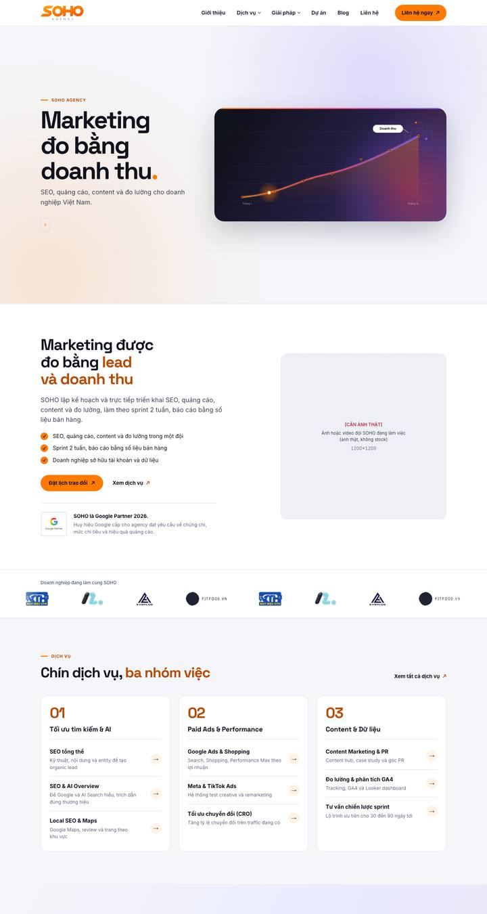 | 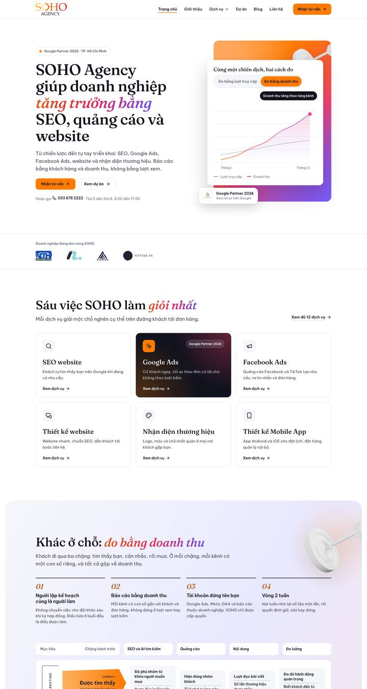 |
| Mobile 390px | 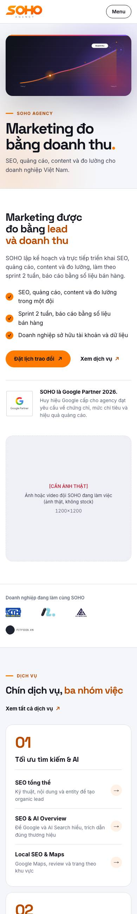 | 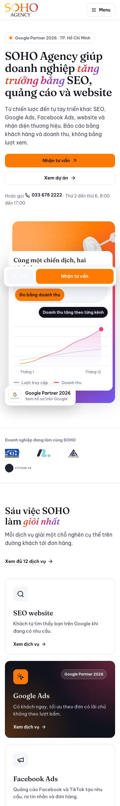 |

### A5. Kiểm tra responsive và truy cập

- **Tràn ngang:** 41 trang × 7 khổ (320, 375, 390, 768, 1024, 1440, 1920) = 287 lần đo, 0 trang tràn.
- **HTML tĩnh:** mỗi trang đúng một H1, không nhảy cấp tiêu đề, ảnh đủ `alt`, không trùng `id`, đủ canonical, title, description. 0 link hỏng trong 1.247 link nội bộ.
- **Console:** sạch trên 13 trang mẫu. Trang 404 chỉ có lỗi 404 mong đợi.
- **Bàn phím:**
  - Phím Tab đầu tiên tới link bỏ qua.
  - Menu mobile giữ focus bên trong; Esc đóng menu và trả focus về nút Menu; mở khóa cuộn khi đóng.
  - Accordion quy trình mở và đóng bằng Enter hoặc Space; mục đóng không nhận focus.
- **Form:** kiểm tra ở cả ba chế độ.
  - Gửi rỗng: hiện 4 lỗi và focus vào ô đầu.
  - Máy chủ trả 200: báo đã gửi.
  - Máy chủ trả 500: báo lỗi, giữ dữ liệu, nút đổi thành "Gửi lại".

### A6. Hiệu năng, truy cập, SEO (Lighthouse 12.6, mobile)

| Trang | Hiệu năng | LCP | Truy cập | SEO |
|---|---|---|---|---|
| Trang chủ `main` (đang chạy) | 93 | 2,6 s | 96 | 100 |
| Trang chủ nhánh, trước đợt này | 76 | 5,8 s | 96 | 100 |
| Trang chủ sau đợt Master Brief | 88 | 3,7 s | 100 | 100 |
| Trang dịch vụ sau | 89 | 3,4 s | 100 | 100 |
| Trang liên hệ sau | 95 | 2,8 s | 100 | 100 |
| Trang chủ sau, desktop | 100 | 0,8 s | 100 | 100 |

Trang chủ trên `main` có LCP thấp hơn vì phần tử lớn nhất ở màn hình đầu là biểu đồ SVG nhỏ, còn bản mới là tiêu đề dùng phông chữ tải từ mạng. LCP mobile vẫn trên ngưỡng 2,5 giây, xem mục "Còn tồn đọng".

### A7. Build và deploy

```bash
npm run build                 # xuất 41 trang HTML vào out/
vercel --prod                 # hoặc merge vào main, Vercel tự deploy
```

Biến môi trường trên Vercel:

- `NEXT_PUBLIC_SITE_URL`: tên miền chính thức. Mặc định là `https://soho-agency.vercel.app`.
- `NEXT_PUBLIC_FORM_ENDPOINT`: địa chỉ nhận form. Xem README mục "Form liên hệ".

Nhánh `minimal-v4` chưa merge và chưa deploy.

---

## B. Mega Menu dịch vụ

### B1. Tóm tắt

- **Menu chính:** Trang chủ, Giới thiệu, Dịch vụ (mở Mega Menu), Dự án, Tin tức, Liên hệ, cùng nút chính "Nhận tư vấn". Header cao 76px.
- **Panel:** rộng 1120px, bo 20px, gồm 3 nhóm dịch vụ:
  - Performance Marketing: SEO Website, Google Ads, Facebook Ads.
  - Digital Experiences: Thiết kế Website, Thiết kế Mobile App.
  - Brand Identity: Nhận diện thương hiệu.
- **Khối CTA cuối panel:** trải ngang, gồm câu "Bạn chưa biết bắt đầu từ đâu?", nút "Nhận tư vấn" và link "Xem tất cả dịch vụ".
- **Không thêm gì mới:** 6 dịch vụ đều trỏ tới trang `/dich-vu/...` đã có. Mô tả và icon lấy từ dữ liệu sẵn có. Không thêm URL, dịch vụ, giá hay lời khẳng định nào.
- **Đổi nhãn:** "Blog" thành "Tin tức" ở menu, footer, breadcrumb và trang 404. URL `/blog/` giữ nguyên.

| Desktop 1440px, đang ở trang Google Ads | Mobile 390px, đang ở trang SEO |
|---|---|
| 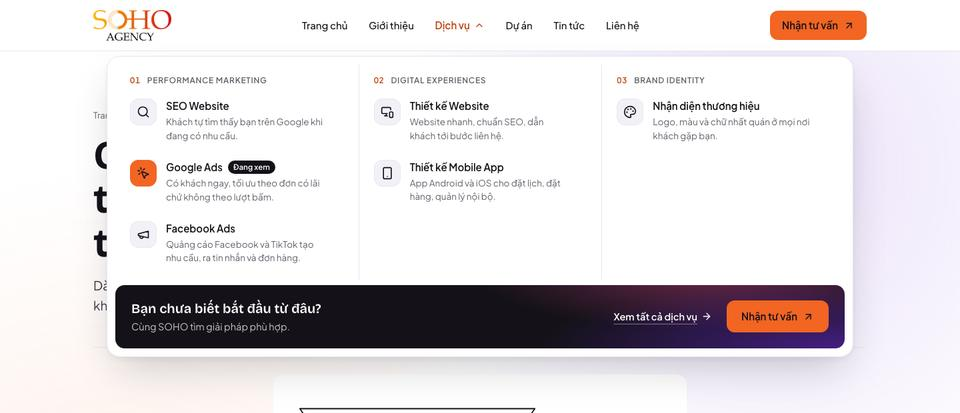 | 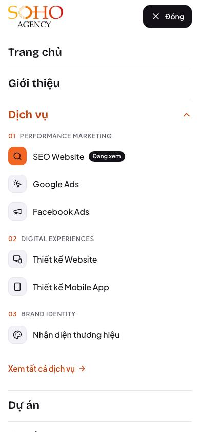 |

### B2. Cấu trúc component (`components/header/`)

| File | Loại | Việc |
|---|---|---|
| `navigation.js` | dữ liệu | Menu chính, 3 nhóm dịch vụ, nội dung CTA. Sửa menu chỉ cần sửa file này |
| `SiteHeader.js` | server | Logo, dựng dữ liệu menu một lần rồi truyền xuống |
| `DesktopNavigation.js` | client | Nút "Dịch vụ", trạng thái mở, bàn phím, bấm ra ngoài, sự kiện GA4 |
| `ServicesMegaMenu.js` | | Panel 3 cột + CTA |
| `ServiceMenuItem.js` | | Một dịch vụ: icon, tên, mô tả; bản gọn cho mobile |
| `MegaMenuCTA.js` | | Khối CTA, dùng chung cho panel và drawer |
| `MobileNavigation.js` | client | Nút Menu, drawer, khóa cuộn, giữ focus |
| `MobileServiceAccordion.js` | | Accordion "Dịch vụ" trong drawer |
| `navUtils.js`, `HeaderScroll.js` | client | Breakpoint 1000px, so trang hiện tại, bóng header khi cuộn |

`components/Header.js` chỉ còn trỏ tới `SiteHeader`, nên các trang không phải sửa import. Dữ liệu dịch vụ không lọt vào bundle JS của trình duyệt (đã kiểm tra).

### B3. Tương tác và truy cập

Theo mẫu Disclosure Navigation của WAI-ARIA: nút có `aria-expanded` và `aria-controls`, bên trong là link thường, không dùng `role="menu"`.

Kiểm tra tự động bằng Chrome DevTools Protocol: **42/42 đạt**, không lỗi console. Các mục chính:

- **Thứ tự Tab:** link bỏ qua, logo, Trang chủ, Giới thiệu, Dịch vụ. Khi panel đóng, Tab đi thẳng sang Dự án.
- **Bàn phím:**
  - Enter và Space mở hoặc đóng panel, focus giữ ở nút.
  - Tab từ nút đi thẳng vào dịch vụ đầu, qua đủ 8 link rồi ra Dự án, panel tự đóng.
  - Esc đóng panel và trả focus về nút. Mũi tên xuống mở panel và focus dịch vụ đầu.
- **Chuột:**
  - Bấm để mở. Rê chuột vào không tự mở, rê ra không tự đóng.
  - Bấm vào vùng trống trong panel không đóng. Bấm ra ngoài thì đóng.
- **Trang hiện tại:** `aria-current="page"` kèm nhãn chữ "Đang xem", không chỉ báo bằng màu.
- **Focus:** viền 2px nhìn thấy được trên mọi link và nút. Trong khối CTA tối của panel, viền đổi sang trắng.
- **Chuyển động:** 200ms bằng opacity và translateY. Khi bật giảm chuyển động thì không trượt.
- **Đổi khổ màn hình:** kéo qua breakpoint khi panel hoặc drawer đang mở thì tự đóng.
- **Drawer mobile:**
  - Focus vào mục đầu và không thoát ra ngoài sau 20 lần Tab.
  - Khóa cuộn trang; nội dung phía sau `inert`.
  - Esc trả focus về nút Menu.
  - Mọi vùng chạm từ 44px; đang ở trang dịch vụ thì accordion mở sẵn.
- **axe-core 4.10 (WCAG 2.2 AA)** khi panel và drawer đang mở: 0 lỗi.

### B4. Responsive

Đã chụp và kiểm tra ở 320, 375, 390, 768, 1024, 1440 và 1920px.

- Từ 1000px trở lên dùng menu desktop; dưới 1000px dùng drawer.
- Ở 768px, cột drawer giới hạn 560px.
- 41 trang × 7 khổ màn hình: 0 trang tràn ngang.

### B5. GA4

`components/analytics.js` chỉ gửi sự kiện khi trang đã có `gtag` hoặc `dataLayer`. Site chưa cài GA4 nên hiện chưa có sự kiện nào được gửi. Các sự kiện:

- `mega_menu_open`
- `mega_menu_service_click` (kèm `service`, `service_group`)
- `mega_menu_cta_click` (kèm `cta`)

Form liên hệ dùng chung hàm này cho `generate_lead`. Không thêm thư viện.

---

## C. Màu và chữ (Monopo Paris làm hướng tham khảo, không sao chép)

### C1. Phông chữ

| | Bản cũ | Bản mới |
|---|---|---|
| Tiêu đề | Fraunces 500 (có chân, chữ nhấn nghiêng) | **Bricolage Grotesque**: H1/H2 700, H3 600, con số 800 |
| Nội dung | Be Vietnam Pro 400/500/600 | **Plus Jakarta Sans**: 400 đến 700 |
| File font trang chủ tải về | Tối đa 10 file (mỗi độ đậm, mỗi kiểu một file) | 6 file variable, tổng 125 KB (Lighthouse). Chỉ 2 file phông tiêu đề được preload |

Bài thử ẾỨỠẶẰ với phông dự phòng Comic Sans: mọi ký tự đều vẽ bằng đúng phông, không chữ nào bị vá. Dấu chồng (Ế, Ặ, Ằ, ỗ) không bị cắt, kể cả cụm chữ gradient nhờ phần đệm của `.hl`.

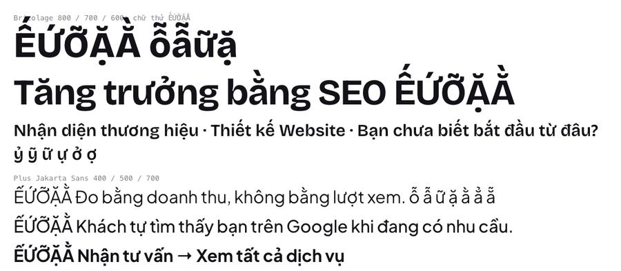

### C2. Màu

Ba lớp token trong `app/styles/tokens.css`:

1. Bảng màu gốc của brief (`--c-*`).
2. Token theo vai trò (`--color-primary`, `--color-text-muted`, `--gradient-signature`...).
3. Tên cũ trỏ về token mới, nên bố cục và component không phải viết lại.

Bảng đầy đủ kèm tỉ số tương phản ở DESIGN.md mục 2.6. Các quyết định chính:

| Quyết định | Lý do |
|---|---|
| Cam `#F26522` chỉ làm nền, chữ trên đó luôn là Dark Ink (5,9:1) | Chữ trắng trên cam chỉ 3,15:1. Đã quét code: không còn chữ trắng trên nền cam |
| Chữ cam nhỏ, link, con số kết quả dùng Deep Orange `#C2410C` (5,18:1) | Cam gốc không đủ 4,5:1 trên nền trắng |
| Cụm chữ nhấn `.hl` dùng gradient đậm `#C2410C → #DB2777 → #6D28D9`; trên nền tối dùng bản sáng | Gradient gốc có đoạn cam và san hô dưới 4,5:1 |
| Soft Canvas `#FAF9FD` cho khối section, kèm viền `#E9E5EF` | `#FAF9FD` chỉ chênh 1,05:1 với nền trắng, không có viền thì khối biến mất |
| Thêm `#F3F1F8` cho ô icon và nền hover | Cần một bậc đậm hơn Soft Canvas để còn thấy được |
| Viền ô nhập `#8E8A99` (3,36:1) | Viền `#E9E5EF` chỉ 1,24:1, không đạt 3:1 cho thành phần giao diện |
| Không dùng `#FFF4E9` | Theo brief. Chỉ còn trong chú thích cấm dùng |

### C3. Bố cục theo hướng mới

- **Hero trang chủ:** chuyển sang kiểu editorial.
  - H1 tới 88px trải hết chiều ngang, 3 dòng ở desktop.
  - Bên dưới là câu giá trị và nút (trái), mảng gradient với biểu đồ (phải).
- **Thẻ dịch vụ:** viền mảnh, chữ tối. Rê chuột thì viền đổi sang Dark Ink, thẻ nhấc lên 3px, ô icon chuyển cam.
- **Dự án:** khối Dark Ink (tone `dark` mới của `Section`) xen giữa các khối sáng; thẻ dự án vẫn trắng để ảnh và số liệu dễ đọc. Trang dịch vụ dùng khối tối cho phần quy trình.
- **CTA cuối trang:** nền gradient tối Dark Ink → tím → mận, quầng cam và tím, form trong thẻ trắng.
- **Tỉ lệ màu:** phần lớn là trắng và nền nhạt. Cam chỉ ở nút, số thứ tự và con số. Tím, san hô và gradient chỉ ở chữ nhấn, mảng hero, khối tối.

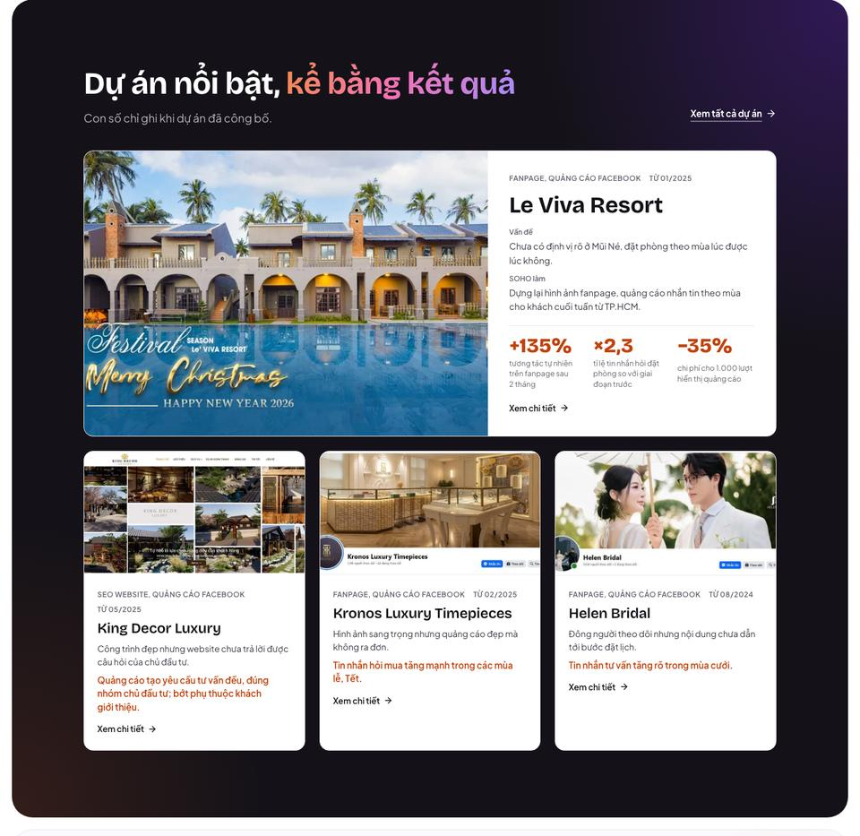

### C4. Trước và sau

| | Trước (`main`) | Sau cả ba phần |
|---|---|---|
| Desktop 1440px |  | 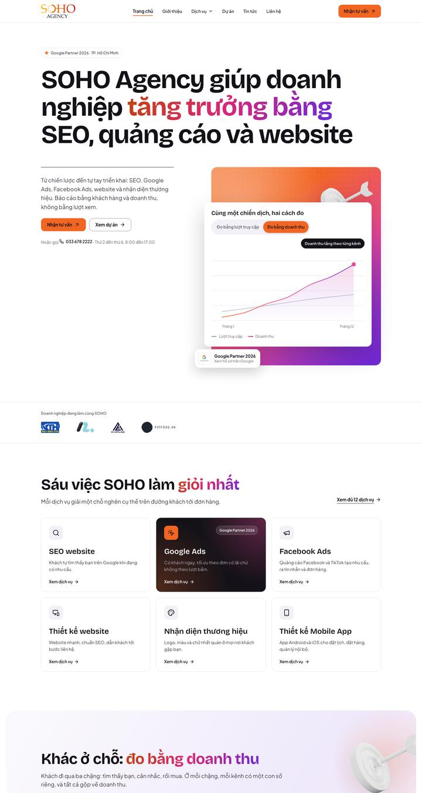 |
| Mobile 390px |  | 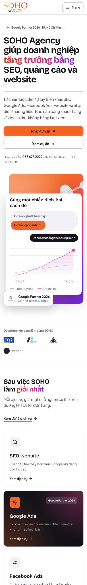 |

### C5. Kiểm tra sau khi đổi màu và chữ

- **Lỗi axe bắt được và đã sửa:** trong khối tối, quy tắc cũ `.dark h3 { color: trắng }` làm tên dự án thành chữ trắng trên thẻ trắng (1:1), không đọc được. Tiêu đề giờ tự lấy màu theo nền.
- **axe-core (WCAG 2.2 AA):** 0 lỗi trên 9 trang và trạng thái.
  - Các ô "cần xem tay" là chữ trên gradient, axe không tự đo được.
  - Đã tính tay ở điểm tối nhất của từng quầng màu: chữ phụ thấp nhất 5,6:1.
  - Chữ phụ khối CTA cuối trang lúc đầu chỉ 3,99:1, đã nâng lên `#D9D6E0`.
- **Tương phản trong Lighthouse:** đạt trên cả 5 trang đo.
- **Không tràn ngang:** 287/287 lần đo.
- **HTML tĩnh:** 0 lỗi, 0 link hỏng trên 2.108 link nội bộ.
- **Console:** sạch trên 13 trang; trang 404 chỉ có lỗi 404 mong đợi.

**Lighthouse 12.6, mobile:**

| Trang | Hiệu năng | LCP | Truy cập | SEO |
|---|---|---|---|---|
| Trang chủ | 92 (trước phần C: 88) | 3,2 s (trước: 3,7 s) | 100 | 100 |
| Dịch vụ SEO | 92 (89) | 3,2 s (3,4 s) | 100 | 100 |
| Liên hệ | 95 (95) | 2,9 s (2,8 s) | 100 | 100 |
| Dự án | 92 | 3,3 s | 100 | 100 |
| Giới thiệu | 93 | 3,1 s | 100 | 100 |
| Trang chủ, desktop | 100 | 0,7 s | 100 | 100 |

**Thử nhúng CSS vào HTML (`experimental.inlineCss`):**

- LCP giảm khoảng 0,3 giây trên hai trang, nằm trong mức dao động giữa các lần đo.
- HTML trang chủ tăng từ 191 KB lên 461 KB, và CSS không còn được lưu đệm giữa các trang.
- Kết luận: không giữ.

### C6. Chỗ cần người chỉnh tay

- **Ảnh bìa blog:** còn logo và màu cũ, cần làm lại theo màu mới (quy tắc ảnh bìa 16:10).
- **Ảnh OG `public/og/soho-og.png`:** vẫn dùng phông và màu bản trước.
- **Logo:** giữ nguyên logo gốc SOHO (gradient vàng đỏ). Logo không theo bảng màu mới, đúng yêu cầu giữ logo.
- **Nhãn nhóm dịch vụ tiếng Anh** (Performance Marketing...): theo brief Mega Menu, nhưng lệch luật "hạn chế tiếng Anh" ở DESIGN.md mục 2.4. SOHO quyết định giữ hay dịch.
- **Hình 3D trang trí** (clay trắng): hợp cả nền sáng và tối. Nếu muốn đồng bộ hơn có thể đổi sang bộ có màu cam và tím.

---

## D. Full Homepage Redesign, Sprint 1: Header và Hero

Brief: "Modern Creative Agency kết hợp Conversion-focused Digital Marketing". Sprint 1 gồm 4 việc:

1. Audit Header và Hero đang chạy.
2. Dựng 2 phương án Hero trên cùng hệ thiết kế.
3. Chụp đối chiếu hai phương án.
4. Chọn một phương án và đưa vào code.

Không làm trang demo riêng: cả hai phương án được dựng ngay trong trang chủ rồi giữ lại một.

### D1. Audit Header và Hero (bản đang chạy, đo bằng Chrome)

| Khổ màn hình | Hero cao | H1 | Nút "Nhận tư vấn" | Hình minh họa bắt đầu ở |
|---|---|---|---|---|
| 1440 × 900 | 1.291 px (khoảng 1,4 màn hình) | 72 ký tự, 3 dòng, 88 px | 743–787 px | 569 px, chỉ lộ 331 px trên màn đầu |
| 390 × 844 | 1.365 px | 5 dòng | 561–605 px | 772 px, gần như dưới màn đầu |
| 360 × 740 | 1.435 px | 6 dòng | 631–675 px | 842 px, dưới màn đầu |

**Vấn đề:**

- **Thông điệp dài:** 72 ký tự, chiếm 5 đến 6 dòng trên điện thoại.
- **Hình không kể hành trình:** biểu đồ "hai cách đo" so sánh lượt truy cập với doanh thu, không cho thấy khách đi từ đâu tới đâu.
- **Huy hiệu Google Partner lặp hai lần:** ở dòng nhãn trên H1 và ở chip góc hình.
- **Header:** đường viền đáy cắt rời header khỏi hero. Nút "Nhận tư vấn" trên header đậm 600 trong khi nút cùng nhãn trong hero đậm 700.

**Giữ nguyên:**

- Mega Menu (42/42 kiểm tra đạt).
- 6 mục menu, nút chính, chiều cao 76 px.
- Drawer mobile.

### D2. Nguyên tắc lấy từ tham chiếu (không sao chép giao diện)

| Tham chiếu | Nguyên tắc dùng cho hero SOHO |
|---|---|
| KOTA | Hero vừa một màn hình. Chữ rất lớn, ngắn, xếp lệch dòng. Trường gradient mờ tràn từ mép. Hàng bằng chứng có tên riêng ở đáy hero |
| Instrument | Bằng chứng thật đứng ngay cạnh lời hứa (tên dự án, không ảnh kho) |
| BASIC/DEPT | Chữ editorial lớn, nhãn nhỏ đi kèm |
| Positivus | Bố cục hai cột rõ việc: lời hứa, nút, hình minh họa |

### D3. Hai phương án

Hai phương án dùng chung:

- **H1:** dòng nhỏ tên + nghề "SOHO Agency · SEO, quảng cáo và website", rồi thông điệp lớn "Từ tìm kiếm đến doanh thu." (H1 vẫn có tên và nghề, đúng luật viết chữ mục 2.4).
- **Câu mô tả, nút và số điện thoại:** giữ nguyên như bản cũ.
- **Hình minh họa:** hành trình 3 chặng lấy từ dữ liệu có sẵn của ma trận hành trình: tên chặng, câu hỏi của khách, con số SOHO đo, gộp về doanh thu theo kênh. Không thêm số liệu nào.

**Phương án A, "Gradient art" (KOTA):**

- Thông điệp hai dòng lệch nhau, tới 100 px.
- Hành trình là các thẻ kính xếp bậc thang trên trường gradient Signature.
- Đáy hero có Google Partner và nhãn "Một số dự án" kèm tên 4 dự án.

**Phương án B, "Conversion split" (Positivus, Instrument):**

- Hai cột.
- Thẻ Dark Ink chứa stepper 3 chặng.
- Cuối thẻ là kết quả đã công bố "Le Viva Resort ×2,3 tỉ lệ tin nhắn hỏi đặt phòng".

| | Desktop 1440 | Mobile 390 |
|---|---|---|
| A | 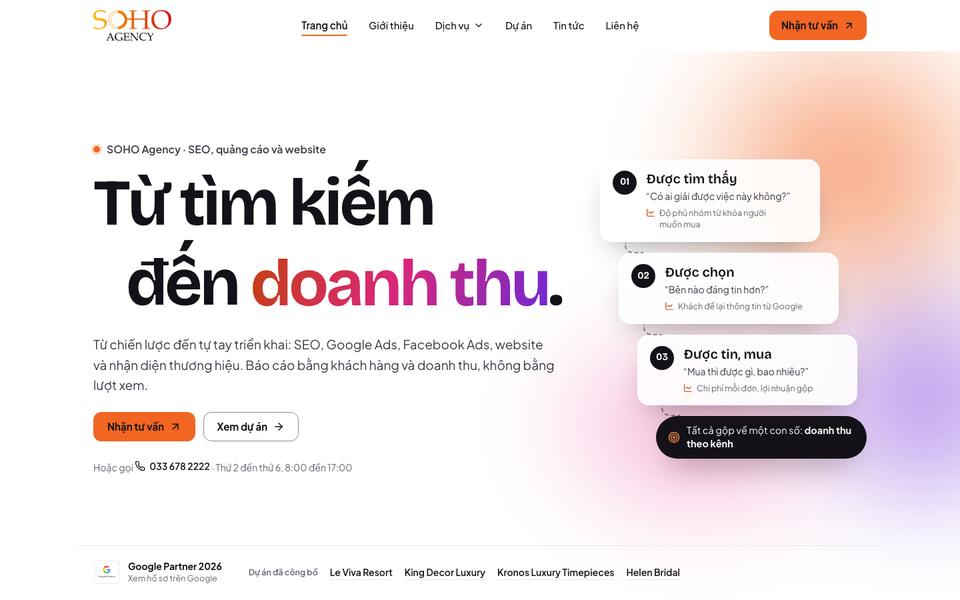 | 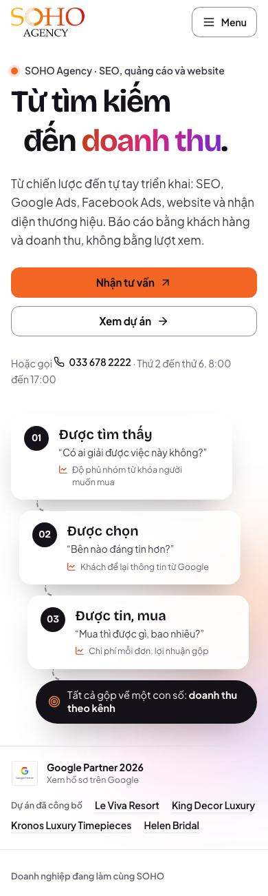 |
| B | 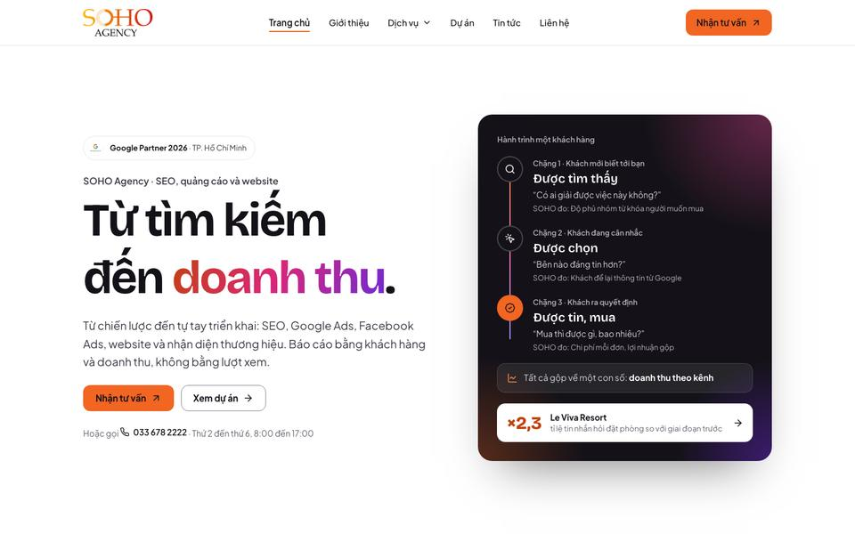 | 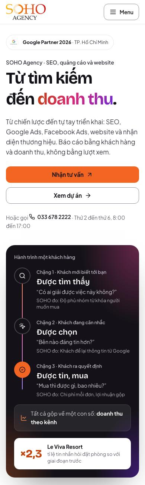 |

### D4. So sánh và lựa chọn

Số đo trên cùng máy, cùng cách đo như mục D1.

| Tiêu chí | Hiện tại | A | B |
|---|---|---|---|
| Hero cao ở 1440 | 1.291 px | **824 px** (vừa màn hình, gồm cả hàng bằng chứng) | 840 px |
| Thông điệp chính ở 390 | 5 dòng | **2 dòng** | 2 dòng |
| Nút "Nhận tư vấn" ở 390 | 561–605 px | **388–432 px** | 446–490 px |
| Hình hành trình bắt đầu ở 390 | 772 px | **601 px** | 657 px |
| Hình hành trình bắt đầu ở 360 × 740 | 842 px (dưới màn đầu) | **621 px** (trong màn đầu) | 684 px |
| Theo nguyên tắc KOTA (chữ lớn, gradient art) | Một phần | Có | Một phần |
| Bằng chứng trong hero | Google Partner | Google Partner + tên 4 dự án | Google Partner + 1 kết quả có số |
| Số khối nền tối trên trang chủ | 2 | 2 | **3**, vượt luật tối đa 2 (DESIGN.md mục 2.6) |
| JavaScript của hero | Có (công tắc biểu đồ) | Không | Không |

**Chọn A**, vì bốn lý do:

1. Đúng hướng KOTA mà brief chọn cho hero.
2. Vừa một màn hình desktop.
3. Trên điện thoại, nút và hình hành trình lên cao nhất.
4. Không thêm khối tối thứ ba.

Điểm mạnh của B là con số đã công bố của Le Viva ngay trong hero. Phần này sẽ đưa vào Trust Bar và Portfolio ở sprint sau, không mất đi.

### D5. Đã triển khai

| File | Thay đổi |
|---|---|
| `components/hero/HomeHero.js`, `.module.css` | Hero mới (phương án A), server component, không JavaScript. Chuyển động chỉ bằng CSS, tắt khi giảm chuyển động |
| `components/data/journey.js` (mới) | 3 chặng hành trình dùng chung cho hero và `JourneyMatrix` |
| `components/diagrams/JourneyMatrix.js` | Đọc dữ liệu từ `journey.js`, nội dung không đổi |
| `app/page.js`, `page.module.css` | Công tắc "Cùng một chiến dịch, hai cách đo" chuyển xuống khối "Khác ở chỗ: đo bằng doanh thu", không mất chức năng |
| `components/header/SiteHeader.module.css` | Ở đầu trang không có viền đáy, hero liền mạch. Nút header đậm 700 như nút trong hero |
| `app/layout.js` | Preload cả phông nội dung. Đo được: LCP mobile 3,3 → 3,2 giây |

Hành trình trong hero là danh sách có thứ tự (`<ol>`), trình đọc màn hình đọc được. Mỗi chặng đọc kèm "Chặng 1:", "Chặng 2:", "Chặng 3:".

### D6. Trước và sau

| | Trước | Sau Sprint 1 |
|---|---|---|
| Desktop 1440 | 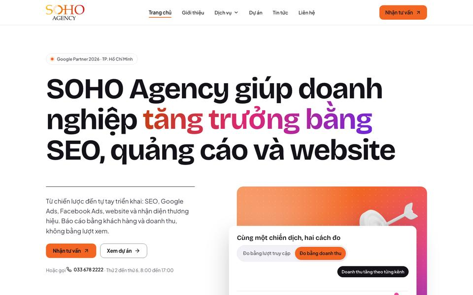 |  |
| Mobile 390 | 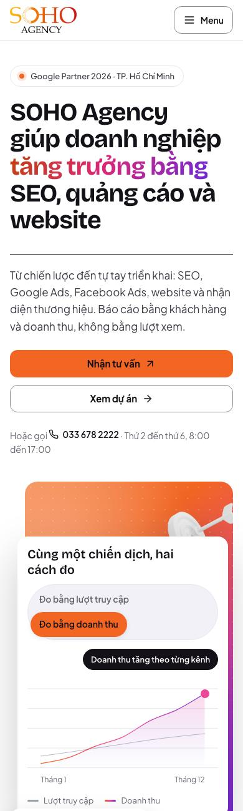 |  |

### D7. Kiểm tra trên bản build

| Hạng mục | Kết quả |
|---|---|
| Build | Đạt, 41 trang HTML |
| HTML tĩnh | 0 lỗi, 0 link hỏng trên 2.112 link nội bộ |
| Tràn ngang | 287/287 lần đo đạt. Riêng hero kiểm thêm ở 7 khổ: H1 không vượt lề, ở 320 px kết thúc tại 304 px |
| Mega Menu (bàn phím, ARIA) | 42/42 đạt, không lỗi console |
| axe-core WCAG 2.2 AA | 0 lỗi trên 9 trang và trạng thái |
| Lighthouse mobile, trang chủ, 2 lần | Hiệu năng 93, LCP 3,2 s, CLS 0, truy cập 100, SEO 100 |
| Lighthouse desktop | 100 / 100 / 100 / 100, LCP 0,7 s |

LCP mobile chưa đạt ngưỡng 2,5 giây và gần như không đổi so với trước (3,2 giây). Phần lớn là thời gian chờ trước khi vẽ (khoảng 2,8 giây: CSS chặn hiển thị và tải phông, trong mô phỏng 4G chậm), không do hero mới. Hướng xử lý ghi ở mục "Còn tồn đọng".

### D8. Các sprint tiếp theo (chưa làm)

| Hạng mục brief | Trạng thái |
|---|---|
| 1. Hero | **Xong** (Sprint 1) |
| 2. Mega Menu đồng bộ với Hero | **Xong phần header** (viền, nút). Mega Menu giữ nguyên vì đạt kiểm tra |
| 3. Dịch vụ dạng Bento Grid | Chưa làm |
| 4. Portfolio dạng hình ảnh, kết quả có kiểm chứng | Chưa làm |
| 5. Ma trận hành trình thành stepper 3 chặng có tương tác | Chưa làm. Dữ liệu đã tách sẵn ở `journey.js` |
| 6. Gộp "Vì sao SOHO" và "Quy trình" | Chưa làm. Công tắc hai cách đo tạm đặt trong khối khác biệt |
| 7. Trust Bar và nhận xét | Chưa làm. Dự kiến đưa kết quả Le Viva từ phương án B vào đây |
| 8. Blog kiểu editorial | Chưa làm |
| 9. FAQ accordion | Đã có từ trước (FAQ 6 câu, có schema), chưa làm lại |
| 10. Form gửi dữ liệu thật | Code đã sẵn (`NEXT_PUBLIC_FORM_ENDPOINT`). Cần SOHO chọn nơi nhận |
| 11. Footer theo hệ thiết kế | Chưa làm |

---

## E. Brand Identity 3.0: logo Open Corner và banner cinematic 3D

Nguồn: `SOHO_Approved_Logo01_Demo_Style_Banners.zip` (logo Concept 01 đã duyệt, 3 bộ banner A/B/C, ảnh preview demo). Ảnh preview chỉ dùng để đối chiếu, không đưa lên web.

### E1. Audit trước khi sửa

| Hạng mục | Hiện trạng | Quyết định |
|---|---|---|
| Framework | Next.js 15 App Router, xuất tĩnh, CSS Modules, không thư viện animation | Giữ, chỉ dùng CSS |
| Trang chủ | `app/page.js`, hero `components/hero/HomeHero.js` | Sửa hero, dịch vụ, dự án, CTA |
| Header và mobile | `components/header/*`, nền trắng, logo ngang `soho-logo-horizontal.svg` | Header nền Midnight, logo mới; Mega Menu và drawer giữ nguyên chức năng |
| Logo footer | `soho-logo-white.svg` | Thay bằng logo đã duyệt |
| Thẻ dịch vụ | `components/home/ServicesGrid.js`, thẻ trắng + icon hình | Thẻ tối + hình hình học riêng |
| Dự án | `components/home/ProjectShowcase.js`, khối tối, thẻ trắng | Thẻ tối kiểu tạp chí, giữ ảnh và tên dự án thật |
| CTA cuối | `components/ui/CtaBand.js`, có form liên hệ | Concept C, giữ nguyên form |
| Token | `app/styles/tokens.css` | Thêm `--soho-*` trỏ về cùng giá trị |
| SEO | metadata, canonical, JSON-LD, OG | Không đổi |
| Lint / type-check | `package.json` không có script `lint` hay `typecheck` | Chỉ chạy được `npm run build` |

### E2. Đã triển khai

| File | Thay đổi |
|---|---|
| `public/assets/brand/approved/SOHO_01_Open_Corner_APPROVED.svg` | Logo đã duyệt, copy nguyên file từ ZIP |
| `public/banners/A_*.webp`, `C_*.webp` | Banner Concept A (hero) và C (CTA), desktop 1920×960 và mobile 900×1200 |
| `components/header/SiteHeader.*`, `MobileNavigation.module.css` | Header nền Midnight, logo 52 px (44 px mobile), chữ menu trắng, viền focus trắng |
| `components/Footer.*` | Logo mới 72 px |
| `components/hero/HomeHero.*` | Nền Midnight, ảnh A neo phải, chữ trắng bên trái, nhãn cam. Mobile: chữ và nút trước, ảnh mobile bên dưới (chỉ lấy phần hình ở đáy ảnh) |
| `components/home/ServiceArt.js` (mới), `ServicesGrid.*` | 6 hình hình học SVG riêng cho từng dịch vụ, thẻ tối, số cam, tên trắng; khối dịch vụ chuyển sang nền tối |
| `components/home/ProjectShowcase.module.css` | Thẻ dự án tối, khung ảnh lớn, số liệu cam sáng |
| `components/ui/CtaBand.*` | Concept C bên phải, tiêu đề, mô tả và form bên trái; mobile có dải ảnh riêng phía trên |
| `app/styles/tokens.css` | Token `--soho-orange`, `--soho-coral`, `--soho-violet`, `--soho-midnight`, `--soho-white`, `--soho-canvas`, `--soho-gradient` |
| `components/article/Markdown.js`, `app/ket-qua/page.js` | Bảng cuộn ngang nhận được focus bàn phím (lỗi axe có từ trước) |
| `DESIGN.md` | Mục 2.5b, luật khối tối mới |

Logo cũ giữ nguyên trong `public/brand/` và `public/assets/brand/` làm bản dự phòng. Không ghi đè file vector gốc.

**Nội dung giữ nguyên:**

- H1 "SOHO Agency · SEO, quảng cáo và website: Từ tìm kiếm đến doanh thu.", đoạn mô tả, hai nút, số điện thoại, Google Partner và tên dự án.
- Không dùng chữ mẫu của bản demo ("Đừng chỉ tăng lượt truy cập...").
- Danh sách 3 chặng hành trình rời khỏi hero, vì ma trận hành trình ngay bên dưới đã có đủ nội dung đó.

### E3. Trước và sau

| | Trước | Sau |
|---|---|---|
| Desktop 1440 | 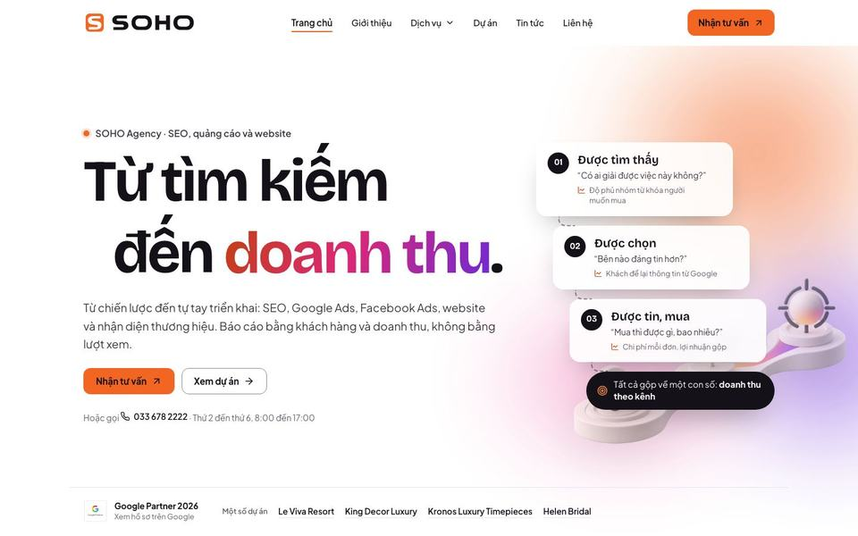 | 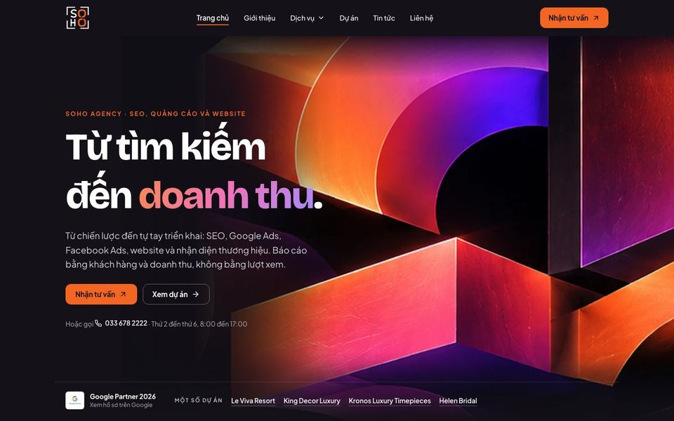 |
| Mobile 390 | 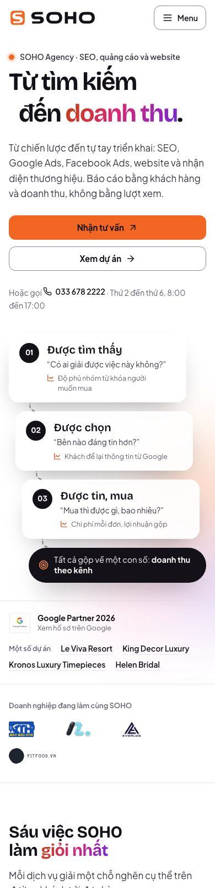 | 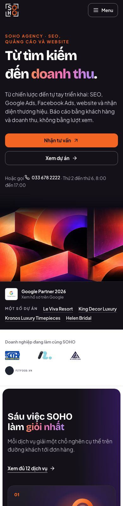 |

**Các khổ khác:** 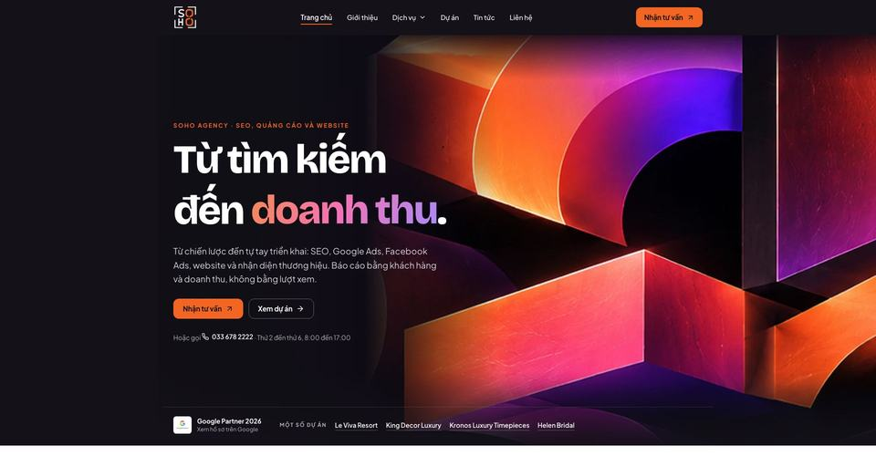 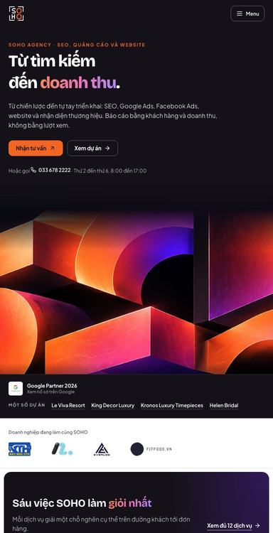 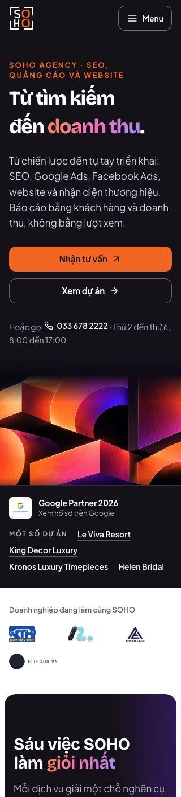

**Mega Menu trên header tối:** 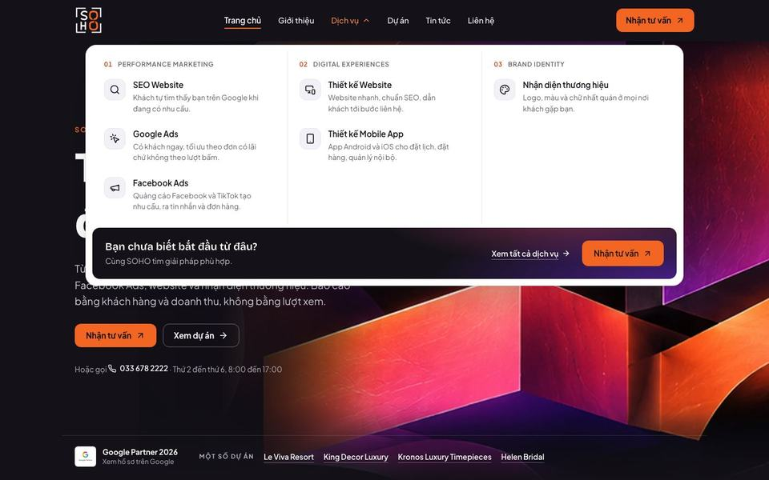

**Dịch vụ và dự án:** 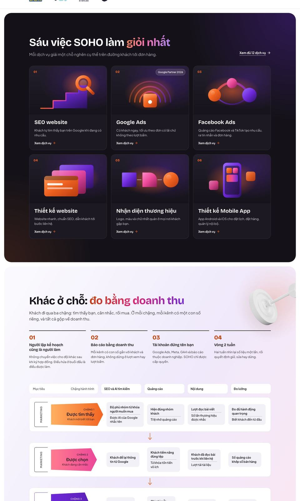

**CTA Concept C:** 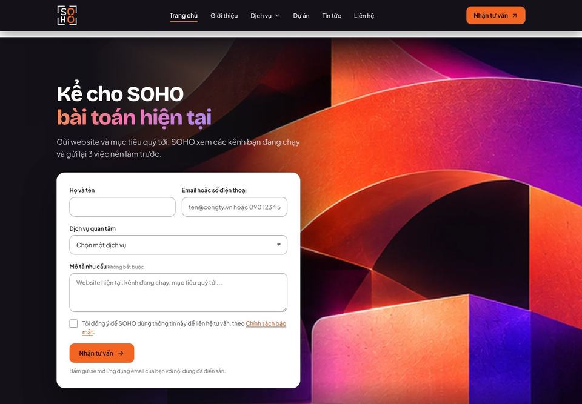

### E4. Kiểm tra (trên bản build tĩnh)

| Hạng mục | Kết quả |
|---|---|
| `npm run build` | Đạt, 44 trang HTML |
| Link và ảnh nội bộ | 0 hỏng. Mỗi trang đúng 1 H1 |
| Tràn ngang, ảnh không tải, lỗi console | 64/64 đạt: 8 trang × 8 khổ (320, 375, 390, 430, 768, 1024, 1440, 1920) |
| axe-core WCAG 2.2 AA | 0 lỗi trên trang chủ, liên hệ, dịch vụ SEO ở 1440 và 390 (sau khi sửa bảng cuộn ngang) |
| Lighthouse mobile, trang chủ, 2 lần | Hiệu năng 92, LCP 3,2–3,3 s, CLS 0, truy cập 100, SEO 100 |
| Lighthouse desktop | 100 / 100 / 100 / 100, LCP 0,7 s, CLS 0 |
| Lint, type-check | Không chạy được: dự án không có script |

### E5. Giới hạn và việc cần duyệt

- **Ảnh dịch vụ:** 6 hình thẻ dịch vụ là SVG hình học vẽ tay theo cùng bảng màu, không phải ảnh render 3D như banner. Muốn đồng bộ hoàn toàn cần render 6 ảnh riêng.
- **Độ phân giải banner:** theo README của gói ZIP, banner được dựng lại từ ảnh concept, không phải bản xuất gốc. Trên màn hình mật độ điểm ảnh rất cao có thể thấy hơi mềm.
- **Ảnh mobile:** banner mobile để trống nửa trên cho chữ. Vì chữ đã nằm phía trên, site chỉ lấy phần hình ở đáy ảnh.
- **Header tối trên mọi trang:** trang con vẫn có hero sáng, nên ranh giới header và hero rõ hơn trước.
- **Ảnh OG chưa làm lại theo logo mới.** Brief để mục này tùy chọn; tôi chưa làm.
- **Thẻ "Google Partner 2026" trên thẻ dịch vụ** vẫn hiện như cũ.
- **Chưa deploy.**

---

## Còn tồn đọng

| Việc | Ai cần làm |
|---|---|
| LCP mobile 2,9 đến 3,3 giây, vẫn trên ngưỡng 2,5 giây (đo giả lập 4G chậm). Phần lớn là CSS chặn hiển thị. Đã thử nhúng CSS vào HTML (mục C5): không đáng | Dev: đo số liệu người dùng thật trên Vercel (Speed Insights) trước khi tối ưu thêm |
| Form chưa có endpoint thật, đang mở ứng dụng email | SOHO chọn Formspree, Google Apps Script hoặc CRM |
| Chưa cài GA4 hay Google Tag Manager, nên sự kiện Mega Menu và `generate_lead` chưa được gửi | SOHO cấp mã đo lường |
| Chính sách bảo mật và điều khoản trên sohoagency.vn chép từ PalAmerican | SOHO cung cấp bản riêng |
| Bài blog cũ trên sohoagency.vn chỉ chuyển về `/blog/`, chưa về đúng bài | Cần danh sách URL cũ |
| Logo Thegioidotap không tìm được; logo Studio 1 Nhà đọc thành "12." | SOHO gửi file logo |
| Quy trình 4 bước cần SOHO xác nhận | SOHO |
| Ảnh bìa blog và ảnh OG còn màu và logo cũ | Thiết kế lại theo màu mới |
| Nhãn nhóm dịch vụ tiếng Anh trong Mega Menu | SOHO quyết định giữ hay dịch |
| Nhánh `minimal-v4` chưa merge, chưa deploy | Chờ duyệt |
